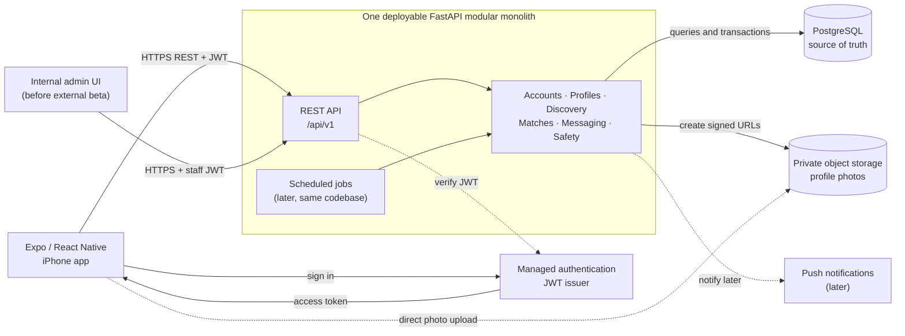
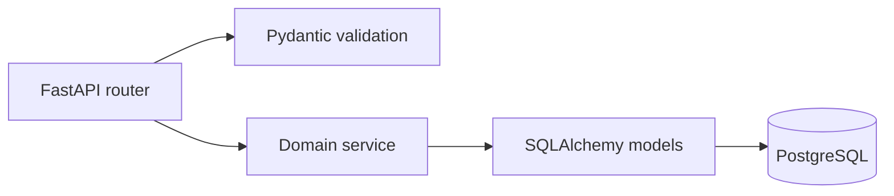

# Dating MVP — High-Level System Design

## MVP architecture



## Backend structure

The backend is a modular monolith: one deployed service containing separate feature modules.



The intended dependency direction is:

```text
HTTP router → domain service → database model → PostgreSQL
```

Routers should remain thin. Business rules and database transactions belong in domain services.

## Architecture decisions

- **Backend:** one FastAPI modular monolith.
- **API:** REST under `/api/v1`; GraphQL is deferred.
- **Database:** PostgreSQL is the source of truth.
- **Cache:** no Redis or server cache for the MVP. Add one only after measuring a need.
- **Messaging:** persisted REST messages with polling first; WebSockets later if needed.
- **Background work:** start with management commands or scheduled jobs from the same codebase.
- **Media:** private object storage with short-lived signed URLs, added after profiles work.
- **Authentication:** use a managed identity provider to issue JWTs; FastAPI owns application authorization.

## Why there is no cache yet

PostgreSQL with appropriate indexes is sufficient for an invite-only MVP. The mobile client may
temporarily cache responses, and object storage or a CDN may cache image bytes, but sensitive
profile, introduction, match, and message responses should not use a shared public cache.

Redis may be introduced later for a measured requirement such as distributed rate limiting,
WebSocket pub/sub, durable background jobs, or a repeatedly expensive query that cannot be fixed
with better SQL and indexes.

## Initial backend modules

```text
app/
├── main.py
├── core/
│   ├── config.py
│   ├── security.py
│   └── errors.py
├── db/
│   ├── base.py
│   └── session.py
├── accounts/
├── profiles/
├── discovery/
├── matches/
├── messaging/
└── safety/
```

Each feature module may contain:

```text
router.py      HTTP endpoints
schemas.py     Pydantic request and response models
models.py      SQLAlchemy database models
service.py     Business logic and transactions
```

## Foundation milestone

The first milestone proves that:

1. FastAPI starts and exposes liveness and readiness endpoints.
2. PostgreSQL runs locally in Docker.
3. SQLAlchemy connects to PostgreSQL.
4. Alembic can migrate a clean database.
5. Automated tests, linting, and type checking run locally and in CI.

The first meaningful vertical slice will prove that an authenticated user can save and retrieve
their profile while authorization tests prevent them from reading or modifying another user's
private data.
